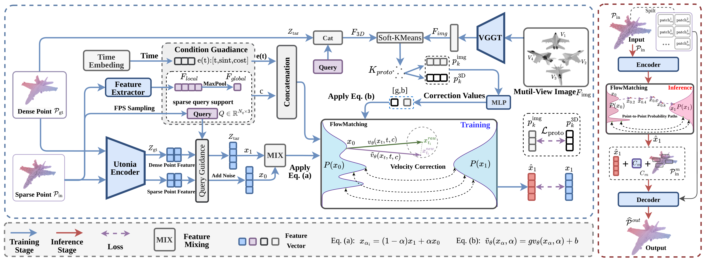
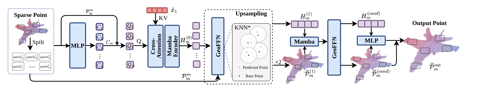
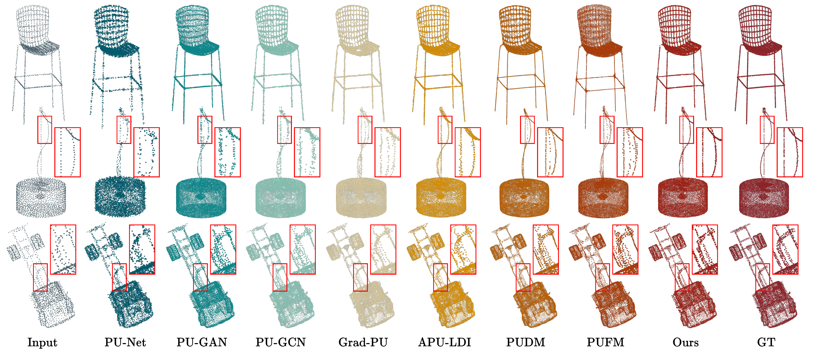
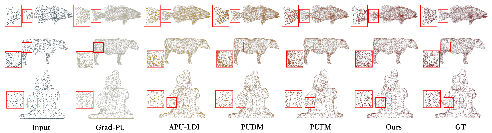

<h1 align="center">ControlFlow3D</h1>
<h3 align="center">Distilling Multi-View Knowledge into Latent Flow Matching for Point Cloud Upsampling</h3>
<p align="center">Official PyTorch implementation of our <b>NeurIPS 2026</b> paper, including training, evaluation and feature preparation.</p>
<p align="center"><b>Multi-view knowledge at training time. Point-cloud-only upsampling at inference.</b></p>
<p align="center">
  <a href="https://arxiv.org/abs/2610.21190"></a>
  <a href="https://drive.google.com/drive/folders/1Q2PHsJjLeunaD4E-fMe1kjfxKZ6iYM31?usp=sharing"></a>
  <a href="https://huggingface.co/datasets/BaldFatTiger/ShapeNetPU"></a>
  <a href="#citation"></a>
</p>
<p align="center">
  <a href="#overview">Overview</a> |
  <a href="#installation">Installation</a> |
  <a href="#reproduction">Reproduction</a> |
  <a href="#training">Training</a> |
  <a href="#evaluation">Evaluation</a>
</p>

<a id="news"></a>

## 📰 News

- 🚀 **2026-10-24:** Code and [pretrained weights](#pretrained-model) are released.
- 🗂️ **2026-10-07:** [ShapeNetPU](#shapenetpu-dataset) is released.
- 🎉 **2026-09-25:** ControlFlow3D is accepted to **NeurIPS 2026**.

<a id="overview"></a>

## 🌟 Overview

Sparse point clouds provide incomplete observations of the underlying surface,
making dense geometry ambiguous. **ControlFlow3D** distills knowledge from
pretrained foundation models into a lightweight generation network during
training, enabling point-cloud-only inference. The generative process operates
in a structured latent space rather than raw coordinates.

<p align="center">
  
</p>

The method has three main components:

- **Conditional latent flow matching.** A frozen Utonia encoder defines the
  structured latent space, while sparse geometry provides local and global
  conditions for feature generation.
- **Unsupervised shared-prototype distillation.** VGGT image tokens and Utonia
  3D target tokens are jointly clustered by soft KMeans without pixel-to-point
  supervision. Prototype consistency aligns the two modalities, while velocity
  control transfers multi-view knowledge into the base network.
- **Mamba-based geometry decoding.** A two-stage decoder maps generated latent
  features to dense coordinates, combining linear-complexity sequence modeling
  with local geometry modeling.

<p align="center">
  
  <br>
  <em>Mamba-based geometry decoder.</em>
</p>

<a id="results"></a>

## 📊 Qualitative Results

4x point cloud upsampling on ShapeNetPU and PU-GAN:

<a id="shapenetpu-results"></a>

### ShapeNetPU

<p align="center">
  
</p>

<a id="pugan-results"></a>

### PU-GAN

<p align="center">
  
</p>

<a id="shapenetpu-dataset"></a>

## 🗂️ ShapeNetPU Dataset

[**Download ShapeNetPU and read the dataset documentation on Hugging Face**](https://huggingface.co/datasets/BaldFatTiger/ShapeNetPU)

ShapeNetPU is a ShapeNet-derived dataset for **point cloud upsampling**, covering
**13 object categories**.

- **35,762 shapes:** 30,395 for training and 5,367 for testing.
- **Paired point clouds:** 2,048-point sparse inputs and 8,192-point dense ground truth.
- **Multi-view training data:** eight rendered views per training shape, with view lists and rendering metadata.
- **Evaluation geometry:** reference meshes for the test split.

The [dataset card](https://huggingface.co/datasets/BaldFatTiger/ShapeNetPU#readme)
provides directory layouts, category-level splits, download instructions,
file-format details and loading examples.

<a id="installation"></a>

## ⚙️ Installation

Reference environment: **Linux, Python 3.10, PyTorch 2.3.1 (CUDA 12.1 runtime),
CUDA 12.2 toolkit**.

```bash
git clone https://github.com/I2-Multimedia-Lab/ControlFlow3D.git
cd ControlFlow3D
conda create -n controlflow3d python=3.10 -y
conda activate controlflow3d

bash install.sh
```

Install CUDA Toolkit first. `install.sh` installs
[`requirements.txt`](requirements.txt) and builds the CUDA extensions.
Run commands from the repository root.

<a id="reproduction"></a>

## 🔁 Reproduction

The workflow is **download data → generate features → optionally build cache → train →
evaluate**. The following commands use the full ShapeNetPU dataset.

### Data preparation

Download [ShapeNetPU from Hugging Face](https://huggingface.co/datasets/BaldFatTiger/ShapeNetPU):

```bash
export HF_ENDPOINT=https://huggingface.co
DATASET_ROOT=data/ShapeNetPU
GPU_ID=0

hf download BaldFatTiger/ShapeNetPU --repo-type dataset \
  --local-dir "$DATASET_ROOT"
```

Raw sample layouts and feature filenames are described in [data/README.md](data/README.md).

### Feature preparation

Set up separate [Utonia](https://github.com/Pointcept/Utonia) and
[VGGT](https://github.com/facebookresearch/vggt) environments using their official
instructions. Place the weights at `weights/utonia/utonia.pth` and
`weights/vggt/model.pt`; see [weight details](weights/README.md).

Training uses Utonia point features and VGGT image features. Testing uses sparse
Utonia features. Set the encoder Python paths below, then run from `controlflow3d`:

```bash
UTONIA_PYTHON=/path/to/utonia-env/bin/python
VGGT_PYTHON=/path/to/vggt-env/bin/python

python utils/prepare_dataset_features.py \
  --dataset_root "$DATASET_ROOT" --split train \
  --utonia_python "$UTONIA_PYTHON" --vggt_python "$VGGT_PYTHON" \
  --include_gt_features --vggt_feature_reduction mean-pool \
  --batch_size 1 --num_workers 0 --gpu_ids "$GPU_ID" --amp

python utils/prepare_dataset_features.py \
  --dataset_root "$DATASET_ROOT" --split test --encoders utonia \
  --utonia_python "$UTONIA_PYTHON" \
  --batch_size 1 --num_workers 0 --gpu_ids "$GPU_ID" --amp
```

**Memmap cache (optional, recommended):** reduces small-file I/O during training.
Source-file loading is also supported; see [data loading](data/README.md#memmap-cache).

```bash
python utils/build_memmap_dataset_cache.py \
  --dataset_root "$DATASET_ROOT" --split all \
  --index_mode part --feature_dtype float16
```

Feature layouts are listed in [data/README.md](data/README.md). After updating
features, rebuild an existing cache with `--overwrite`. For pretrained models,
use matching projection and preprocessing settings; see
[feature projections](weights/README.md#vggt-projection).

<a id="training"></a>

## 🚀 Training

Train on one GPU:

```bash
python train.py \
  --dataset_root "$DATASET_ROOT" --gpu_ids "$GPU_ID" \
  --image_feature_source vggt --index_mode part \
  --epochs 300 --batch_size 8 --val_batch_size 8 \
  --num_workers 4 --prefetch_factor 2 --logdir logs
```

Logs and checkpoints are saved to `logs/<run_dir>/`:

- `last_checkpoint.pth`: resume training.
- `best_val_checkpoint.pth`: best validation CD.

To resume, append `--resume "$RESUME"` to the training command:

```bash
RESUME=$(find logs -name last_checkpoint.pth | sort | tail -n 1)
```

<a id="evaluation"></a>

## 📏 Evaluation

Select the best-validation checkpoint from the most recent training run:

```bash
CHECKPOINT=$(find logs -name best_val_checkpoint.pth | sort | tail -n 1)
python test.py \
  --checkpoint "$CHECKPOINT" --dataset_root "$DATASET_ROOT" \
  --gpu_ids "$GPU_ID" --unit_mode full --inference_index_mode part \
  --full_num_parts 8 --split test --steps 5 \
  --no_copy_mesh_to_gt --save_dir results
```

For CD/HD, predictions and GT are independently centered and scaled to unit
radius. CD sums the two directed mean squared nearest-neighbor distances; HD
sums their maxima. P2F measures mean point-to-mesh distance at the original scale
for samples with GT meshes.

Results include predicted point clouds, overall/category/sample metrics and run
arguments. See `python test.py --help` for additional options.

<a id="pretrained-model"></a>

## 📦 Pretrained model

The released ShapeNetPU checkpoint is available from
[Google Drive](https://drive.google.com/drive/folders/1Q2PHsJjLeunaD4E-fMe1kjfxKZ6iYM31?usp=sharing).
Save it as `checkpoint/ControlFlow3D_ShapeNetPU.pth` and select it with:

```bash
CHECKPOINT=checkpoint/ControlFlow3D_ShapeNetPU.pth
```

Use the same evaluation command above. Checkpoint format and
placement are described in [checkpoint/README.md](checkpoint/README.md).

<a id="citation"></a>

## 📝 Citation

If you find ControlFlow3D or ShapeNetPU useful for your research, please consider
citing our work as an acknowledgment:

```bibtex
@misc{liu2026controlflow3d,
  title={ControlFlow3D: Distilling Multi-View Knowledge into Latent Flow Matching for Point Cloud Upsampling},
  author={Yuang Liu and Zhi Zuo and Zhengkai Zhao and Lirui Zhang and Pan Gao and Hao Feng and Zhengzhe Liu},
  year={2026},
  eprint={2610.21190},
  archivePrefix={arXiv},
  primaryClass={cs.CV},
  url={https://arxiv.org/abs/2610.21190},
}
```

<a id="acknowledgements"></a>

## 🙏 Acknowledgements

We thank the authors of [Utonia](https://github.com/Pointcept/Utonia),
[VGGT](https://github.com/facebookresearch/vggt),
[ShapeNet](https://www.shapenet.org/), and
[3D-R2N2](https://github.com/chrischoy/3D-R2N2), as well as the point cloud
upsampling community, for their open-source contributions.

<a id="license"></a>
<a id="terms-of-use"></a>

## 📜 Terms of Use

Project code is released under the [MIT License](LICENSE).

ShapeNetPU is derived from ShapeNet. Please follow the
[dataset terms of use](https://huggingface.co/datasets/BaldFatTiger/ShapeNetPU#license-and-terms-of-use)
and the applicable upstream licenses.
